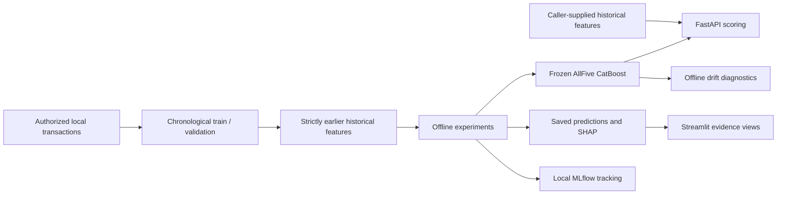

# SentinelGraph AI

Fraud-modeling experiments and a verified local scoring and investigation
demonstration using IEEE-CIS transaction data. Python, CatBoost, PyTorch,
PyTorch Geometric, FastAPI, Streamlit and MLflow.

The public repository contains source and synthetic tests. It does **not**
distribute IEEE-CIS records, fitted research models, private golden fixtures or
local experiment stores. A fresh checkout can run the public workflow without
those artifacts. Running the research-model API/dashboard requires authorized
local artifacts.

## Quick start: public tests

Locally verified platform: Windows x64, Python 3.13, CPU. Linux/Python 3.13 is
the GitHub Actions target; workflow configuration is not hosted CI success.

PowerShell, from the repository root:

```powershell
py -3.13 -m venv .venv
.\.venv\Scripts\python.exe -m pip install -r requirements-public.txt
.\.venv\Scripts\python.exe -m pip check
.\.venv\Scripts\python.exe -B scripts/check_public_snapshot.py
.\.venv\Scripts\python.exe -B -m pytest -q
```

Linux equivalent:

```bash
python3.13 -m venv .venv
.venv/bin/python -m pip install -r requirements-public.txt
.venv/bin/python -m pip check
.venv/bin/python -B scripts/check_public_snapshot.py
.venv/bin/python -B -m pytest -q
```

Use a new environment for a new checkout. Do not recreate/update a preserved
research environment. PyTorch CPU wheels come from the official CPU index.
No credentials, datasets, saved models or running servers are needed. Tests
include toy fits and neural forward/backward passes, never retraining saved
research models. `pytest.ini` limits discovery to `tests/`, excluding archived
copies under outputs. Private checks are deselected by default; a guard blocks
public tests from opening project-private files.

## Architecture



The API accepts **precomputed historical features**; it does not maintain online
feature state or verify the supplied history. The dashboard reads saved evidence
directly, without calling the API or running every model family.

| Component | Entry point | Role |
|---|---|---|
| Historical features | `feature_engineering.py`, `graph_models/temporal_graph_features.py` | Offline strictly earlier history; equal-time isolation |
| Tabular models | `train_baselines.py`, `evaluation/session20_ablations.py` | Offline comparisons; frozen CatBoost used for serving |
| Behavioral models | `deep_learning/run_behavioral.py` | Offline GRU/Transformer and controls |
| GNNs | `graph_models/train_temporal_gnn.py` | Offline GraphSAGE/GAT on historical transaction neighborhoods |
| Proxy components | `graph_models/discover_candidate_clusters.py` | Retrospective card/address proxy-connected components |
| Anomaly models | `anomaly_models/train_anomaly_models.py` | Offline Isolation Forest and autoencoder rankings |
| Fusion | `fusion_models/train_fusion.py` | Chronological holdout stacking of CatBoost/IF/AE |
| Decisions | `decision_models/evaluate_decisions.py` | Offline calibration, capacity and illustrative costs |
| API | `api/main.py` | Local frozen-model inference |
| Dashboard | `dashboard/app.py` | Saved evidence, SHAP, retrospective clusters and drift |
| Tracking | `tracking/` | Posthoc MLflow registration of four Session 20 ablations |
| Monitoring | `monitoring/` | Offline fixed-reference PSI and missingness |
| Integration | `integration/` | Integrity, provenance and cross-component checks |

GCN/basic graph exercises are synthetic tutorials, not additional real-data
benchmarks. `card1`/`addr1` are anonymized proxies, not verified people/accounts
or physical addresses. Connected components do not establish proven fraud rings.

## Development results

Session 20 compared four CatBoost feature groups on the **same 5,000 development
transactions**, including 159 frauds, with shared model settings:

| Features | Average precision |
|---|---:|
| Amount only | 0.048227 |
| Amount plus activity | 0.144062 |
| Amount plus relationships | 0.146785 |
| AllFive | 0.190858 |

AllFive uses amount plus four historical relationship counts. AP gain is
**0.142630 over amount-only**, a deliberately limited control. This does not
establish improvement over a competitive rich current-only model. AP means
`average_precision_score`, not trapezoidal PR-AUC. AllFive Precision@100 was 0.21;
Recall@100 was approximately 0.1321.

Other families used different evaluation populations and are not a fair global
leaderboard. In the matched Session 18 study, CatBoost AP was 0.182366 and
CatBoost+AE AP was 0.181334: fusion did not improve overall AP, although top-100
hits increased from 22 to 29.

Validation repeatedly informed development. Earlier full-data EDA exposed
aggregate outcomes spanning the eventual reserved interval. No independent final
evaluation, pristine untouched-test history, final model approval or validated
financial-loss improvement is claimed. `TransactionDT` is relative event time,
not a calendar timestamp.

## Local API and applications

Install the optional applications in a separate environment:

```powershell
py -3.13 -m venv .venv-apps
.\.venv-apps\Scripts\python.exe -m pip install -r requirements-apps.txt
.\.venv-apps\Scripts\python.exe -m pip check
```

The old `requirements-dashboard.txt` chain records the historical Windows
environment; it is not the public setup path. Use the application environment's
interpreter below (or its `bin/python` equivalent on Linux).

With the exact authorized model restored at
`outputs/evaluation/session20/AllFive.cbm`:

```powershell
.\.venv-apps\Scripts\python.exe -m uvicorn api.main:app --host 127.0.0.1 --port 8000 --workers 1
```

| Route | Behavior |
|---|---|
| `GET /health` | Loaded-model readiness and fingerprint |
| `GET /model-info` | Feature contract, model identity and development scope |
| `POST /predict` | Validated inputs; uncalibrated score, no decision assigned |
| `GET /docs`, `GET /openapi.json` | Interactive documentation and schema |

Synthetic request example; no expected research-model score is invented:

```json
{"transaction_id": 1, "transaction_amount": 25.0,
 "graph_card_prior_degree": 2.0, "graph_product_prior_degree": 8.0,
 "graph_pair_prior_count": 1.0, "graph_card_distinct_products": 2.0}
```

`graph_pair_prior_count` maps to `graph_card_product_prior_count` internally.
Values are raw numerical inputs, without scaling/log transform. Missing history
becomes NaN; zero stays zero. Labels, extra fields, invalid types and negative or
nonfinite values are rejected. Startup verifies SHA-256, feature order and binary
classes. Missing/wrong model bytes fail startup. Supplied counts are not checked
for integer values or historical consistency.

With the additional authorized saved evidence restored:

```powershell
.\.venv-apps\Scripts\python.exe -m streamlit run dashboard/app.py --server.address 127.0.0.1 --server.port 8501 --server.headless true --browser.gatherUsageStats false
.\.venv-apps\Scripts\python.exe tracking/serve_ui.py
```

The dashboard checks keyed predictions and SHAP provenance/additivity. Its
summary is deterministic Python, not an LLM. Retrospective cluster outcomes are
separate and opt-in. MLflow uses local SQLite/artifacts: four models are tracked
as experiment runs, with no Model Registry entries.

Read-only verification of existing offline monitoring:

```powershell
.\.venv-apps\Scripts\python.exe -B -c "from monitoring.verify_session23 import verify_outputs; print(verify_outputs(write_report=False))"
```

PSI diagnoses distribution change, not concept drift or accuracy degradation
without matured outcomes. Applications have no authentication or public deployment
claim. Keep these local demonstrations on loopback.

## Tests and historical evidence

```powershell
# Public synthetic/algorithmic tier
python -B -m pytest -q

# Authorized local workspace: public plus private checks; missing evidence fails
python -B -m pytest --run-private -q
```

The historical Session 26 audit recorded 143 tests, six HTTP golden predictions,
5,000 SHAP records, 20,000 monitoring scores, 24 artifacts and 86 source/document
fingerprints. These are historical local results, not hosted CI results or an
unchanged test count after source evolution. Original dataset-derived golden
vectors remain private, ignored and unchanged.

Publication changes invalidate historical **source** fingerprints, while preserving
the old manifests and artifacts. The separate ignored publication record is
`publication/verification.local.json`. Do not run legacy release build/verification
CLIs against preserved outputs: they write convenience manifests/reports. Never
change expected hashes merely to make old verification pass.

See [reproduction/artifact requirements](docs/REPRODUCING.md),
[public snapshot policy](publication/README.md), and component guides for historical
details. Component guides describe their original session environments and may
contain artifact-writing commands; this README is the current public entry point.

## Planned scope

Heterogeneous user/device/merchant graphs, active learning, DVC, live concept-drift
monitoring, production decisioning, Kafka/Redis/PostgreSQL state, LLM/RAG,
authentication, deployment and rollback are **not implemented** in this release.

The [original research plan](docs/history/original_plan.md) is preserved as a
historical aspirational specification, not today's feature list. Obtain data using
your own authorized account and provider terms. No dataset/model redistribution
rights are granted. A source-code license has not yet been selected.
